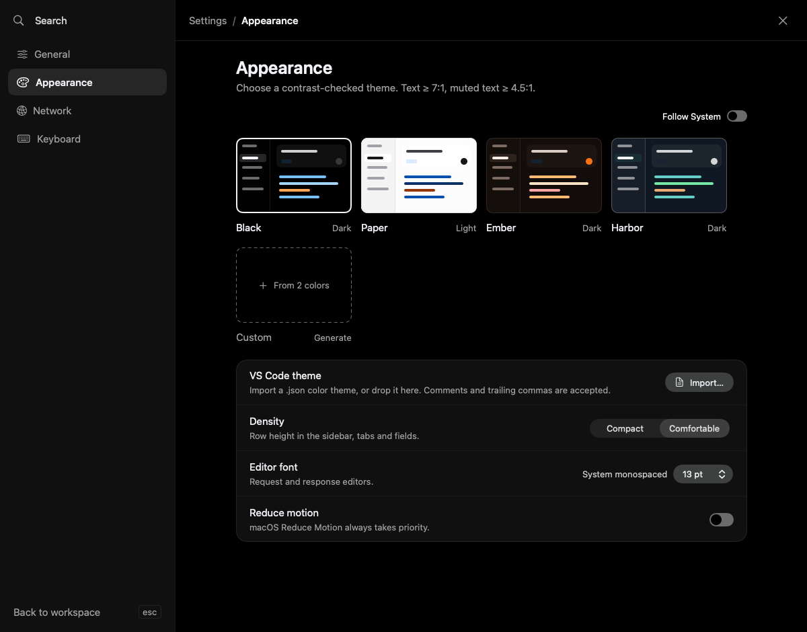

# Appearance

[Documentation](README.md) · [Command Palette](command-palette.md)

Open **Wirebolt → Settings…** (**⌘,**) and select **Appearance**. Appearance preferences apply to this Mac and are not stored in shared workspace files.

## Choose a theme

Choose **Black**, **Paper** or **Ember**, or turn on **Follow System** to follow the Mac's appearance. Theme colors are checked and adjusted for legibility. The system's **Increase Contrast** setting is also supported.

For a quick switch, press **⌘K**, choose **Change theme…**, highlight a theme and confirm with **Return**. Highlighting alone does not apply it.

## Create or import a custom theme

The custom theme card offers **From 2 colors** and a VS Code theme import:

1. Choose a background and accent, or import a VS Code color-theme file.
2. Review the live sample of methods, variables, syntax and status colors.
3. Check any import or contrast-adjustment notices. **Preview Increase Contrast** shows the sample with increased contrast.
4. Enter a name and choose **Save Theme**.

Imported themes are adapted to Wirebolt's controls and syntax colors; import notices explain unsupported input or adjustments. An import error leaves the existing theme available. Saved custom themes can be renamed or deleted from their card's context menu or their Appearance controls. Deleting the active custom theme returns to **Follow System**.

Custom themes are local preferences, separate from request/workspace documents. They are not included when sharing a workspace with Git.

## Density, editor text and motion

- **Compact** fits more content into the same window; **Comfortable** gives rows and controls more space.
- **Editor font** changes the text size in request and response editors.
- **Reduce motion** reduces interface animations. The app also respects the Mac's Reduce Motion setting.

Use **Settings → General** for word wrapping, invisible characters and scrolling beyond the final line. **Settings → Keyboard** lists the built-in shortcuts.
