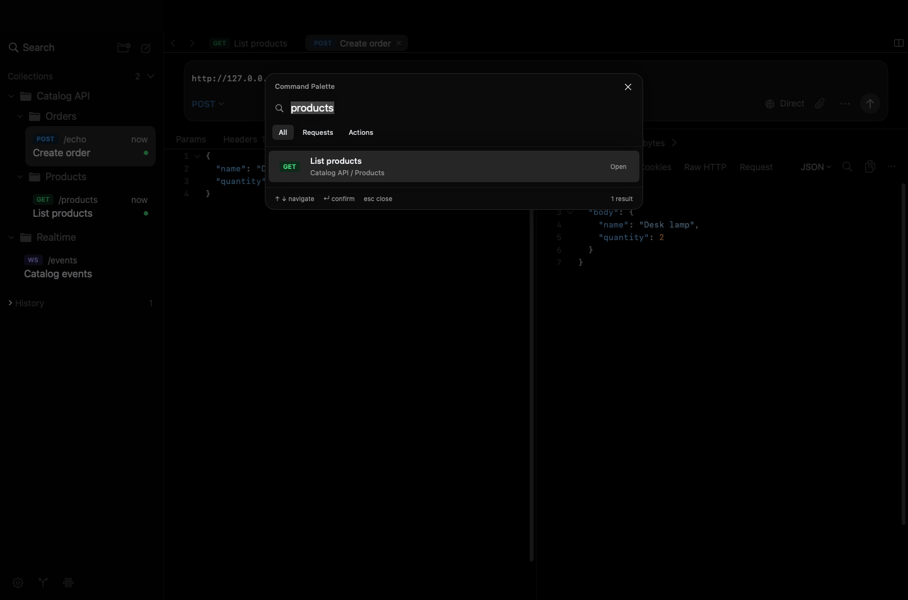
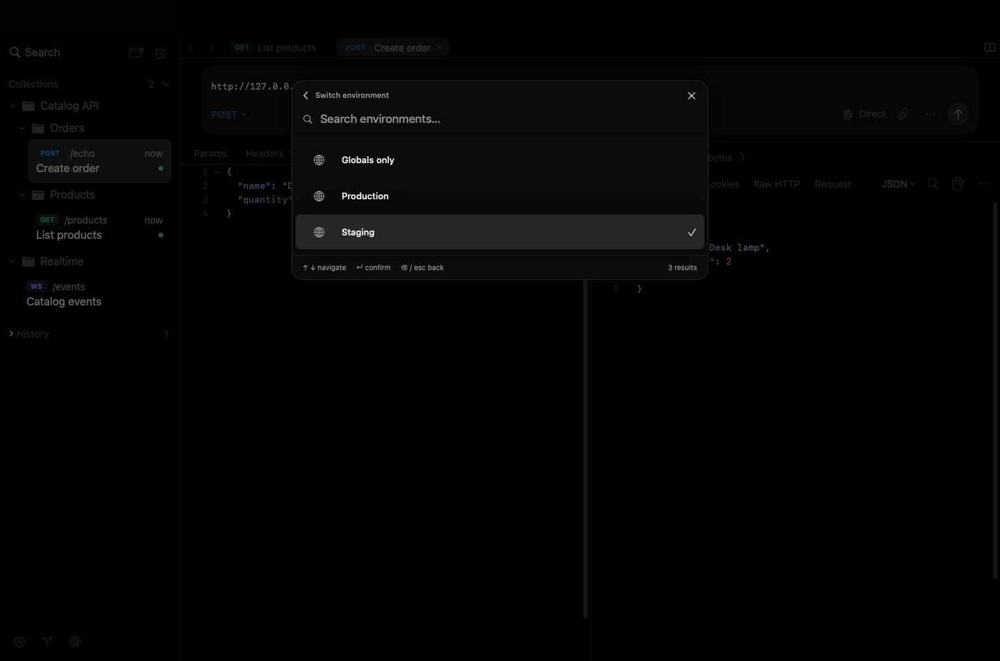
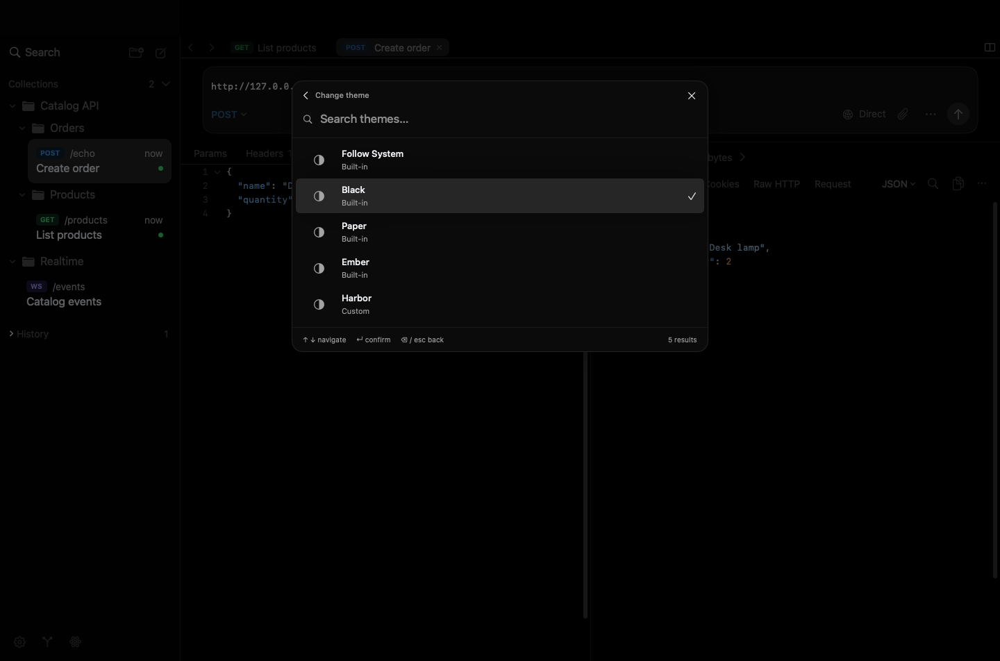

# Command Palette

[Documentation](README.md) · [Keyboard shortcuts](keyboard-shortcuts.md)

Press **⌘K** or choose **Navigate → Command Palette…** to find requests, switch tabs and run common actions in the current workspace.

## Find and open a request

Type a request name, HTTP method, collection or folder name. Search includes closed folders, requests hidden by the sidebar filter and tabs in every split. All query words must match; exact names rank before prefixes and partial matches. Search ignores case and accents.

Use **↑ / ↓** to highlight a result, then **Return** or a click to open it. An **Open** marker identifies an existing tab; **Open in split N** identifies one in another editor group. Wirebolt selects an existing tab when possible, preserving its draft and response. Otherwise, it opens a regular tab. Unsaved tabs are searchable by their current name and method.

With an empty query, the palette shows open requests and unsaved tabs, followed by common actions. Choose **Requests** or **Actions** to narrow the list, or begin the query with `>` to search actions. Results are limited to 50; refine the query when the palette indicates that more match.

## Run an action

Search for actions such as **New Request**, **Filter Requests**, **Split Right**, **Settings**, **Workspace Settings** or **Focus Response**. Available keyboard shortcuts appear beside actions. Unavailable actions explain why they cannot run.

Highlighting a result leaves the workspace in place. **Return** confirms the selected action. Sending requests, connecting WebSockets, acquiring OAuth tokens, testing connections, network Git operations and destructive actions keep their existing controls; they are outside the palette.

## Switch environments and themes

Choose **Switch environment…**, then select **Globals only** or a named environment. The active choice has a checkmark. Confirm with **Return**; the environment changes for future sends. Browsing the list does not change it or send a request. An unfinished environment edit must save successfully before a new environment becomes active.

Choose **Change theme…** for **Follow System**, **Black**, **Paper**, **Ember** or an installed custom theme. Confirming applies the theme across the app. See [Appearance](appearance.md) to create or import themes.

## Return to your work

- **Esc** returns from a submenu to the previous query and selection; at the root, it closes the palette.
- **Backspace** with an empty submenu query also goes back.
- **⌘K**, **⌘W**, the close button or a click outside the palette closes it. **⌘W** leaves the request tab open.
- Canceling returns focus to the editor you came from when it still exists. Confirming a navigation action gives focus to its destination.

The palette opens in the active workspace window. Finish or close Settings, sheets, alerts and rename/close prompts first. It is unavailable during workspace loading, importing, Git or OAuth transitions. Native text composition takes priority over palette keys.

## What is searched

The palette searches names, methods and collection/folder labels. It does not search URLs, headers, bodies, query parameters, notes, variable values, credentials, cookies, responses or WebSocket messages. It does not read Keychain to build results. Queries are temporary and are not saved to workspace files or a persistent search history.

Use **⌘F** inside an editor or response to search its contents, and **⇧⌘F** to filter the sidebar. These searches retain their own scope.
