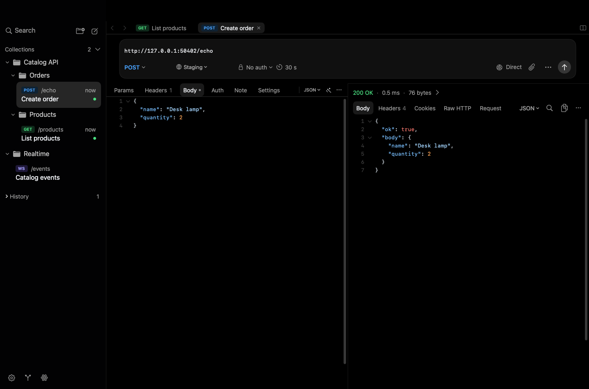

# Requests and responses

[Documentation](README.md)

## Compose a request

Create an HTTP request with **File → New Request** (**⌘N**), the toolbar **+** menu or a collection's context menu. Select a method and enter an `http://` or `https://` URL. **QUERY** ([RFC 10008](https://www.rfc-editor.org/rfc/rfc10008.html)) is a safe, repeatable read that sends a body: put the query in **Body** and keep its content type, which servers require. **Custom…** accepts any other method token. The [quick-start server](examples/demo-server.py) answers `QUERY /products` with a JSON filter such as `{"max_price": 20}`. Save with **⌘S** to persist the draft in a collection.

| Panel | Use it for |
| --- | --- |
| Params | Query parameter rows; unchecked rows are omitted |
| Headers | Request headers; unchecked rows are omitted |
| Body | No Body, JSON, Form URLEncoded, XML, HTML, Raw Text, Multipart or File |
| Auth | Basic, Bearer, API key or OAuth configuration |
| Note | Markdown documentation saved with the request |
| Settings | Request proxy policy and transport overrides |

Below the URL, the composer sets the method, the environment and the authentication kind, and shows the total timeout; click the timeout to open **Settings**. A proxy appears there only when the workspace or the request overrides the app default, or when its configuration is invalid. **Edit Long URL…** and **History** are in the **⋯** menu beside Send; in a narrow editor it also offers Authentication, Network Settings and Attach File.

Switch panels with **⌥⌘1** – **⌥⌘6** (**Navigate → Request Section**). **Request → Add Key** (**⇧⌘K**) adds a Params or Headers row; from any other panel it switches to Params first.

**Format Body** appears only for JSON.

For multipart uploads, choose text or file parts and select the local files. Use **Edit Value…** to edit a part's value from the keyboard. File bodies refer to local paths: sharing a workspace does not upload the file or make that path exist on another Mac.

## Send and cancel

Click **Send** or press **⌘Return**. Send is unavailable until the request has a URL. While the request runs, **Cancel** replaces Send; press **⌘.** or use the **Cancel** button beside the elapsed time in the response area. A response is associated with the tab that sent it. Editing another request or switching tabs does not retarget an in-flight response.

The status beside the URL shows the latest outcome: the response status (for example **200 OK**), **Failed** with the reason in its help tag, or **Cancelled**. In a narrow split editor it shows only the icon.

Sending and saving are separate operations. **Send** uses the current draft; **⌘S** persists its definition. Export and Git use saved definitions.

## Inspect the response

The response area shows status, timing and size. Use its panels to inspect the body, headers, cookies and executed request, or switch with **⌃⌘1** – **⌃⌘5** (**Navigate → Response Section**). **Navigate → Focus Response** (**⌥⌘0**) moves the keyboard focus into the response. The **Request** panel shows **Prepared Request**: a reconstruction of the prepared execution, including its proxy policy. Secrets are redacted and the body may be only a preview; it is not a capture of bytes on the connection.

While a request is resent, the previous response stays visible, dimmed, until the new one arrives. When a request fails, the response area explains the failure and offers **Retry**, **Network Settings** and, when available, **View Request**.

Use the renderer menu for JSON, JSON Tree View, Text, XML, HTML, Webview, Image or Hex as appropriate for the response. A renderer cannot turn incompatible bytes into valid JSON or an image; use Text or Hex to inspect unexpected content.

The HTML source view and Webview serve different purposes. Open a Webview only for content you want to render; Markdown notes use a separate local preview.

## Tabs, split editors and history

Tabs show each request's method and name. Clicking a request in the sidebar opens it in a *preview* tab (italic title) that the next click reuses. Editing or sending the request, double-clicking the tab or ⌘-clicking the sidebar row keeps it open. A dot replaces the close button on tabs with unsaved edits. Switch tabs with **⇧⌘]** / **⇧⌘[**, **⌃Tab** / **⌃⇧Tab** or **⌘1** – **⌘9**.

**⌘K** searches saved requests and open tabs across the workspace by name, method, collection or folder. Confirming a result selects an existing tab when possible, or opens a regular tab; browsing results leaves your current request in place. See [Command Palette](command-palette.md).

Open multiple requests in tabs. **Navigate → Split Right** (**⇧⌘D**) creates a second editor group for comparison. Drafts and responses are independent between document sessions. Save each edited draft you want to retain. Wirebolt reopens your tabs and the latest response of each request at the next launch.

For HTTP requests, open **History** in the composer's **⋯** menu to inspect available prior runs. History is local runtime data, subject to storage limits, and is not included in Git commits.

History follows collection and request IDs. Requests with the same ID in different
collections keep separate responses. Renaming, moving or re-cloning a workspace
folder keeps its history; copies sharing those IDs share history.
Moving a request or saving a tab for the first time carries its history, including
runs already in flight. History for a workspace without a saved folder also
survives relaunch.

**Clear History** deletes this request's entries. **Settings → General → History → Clear All
History** deletes history from every workspace. Responses already displayed in tabs
keep their own temporary body and remain readable after clearing or quota eviction.

Use **Request → Copy cURL** to copy a command representation. Keychain-backed values, including secret variables and proxy credentials, aren't copied: the command reads them with `security find-generic-password` when it runs, so macOS may ask to allow access, and it works only on a Mac that has those Keychain items. Review the clipboard content before sharing: URLs, bodies and other text you typed are copied as is.
